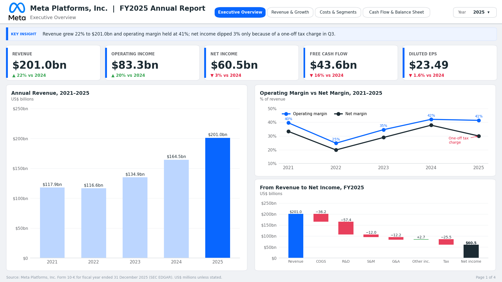
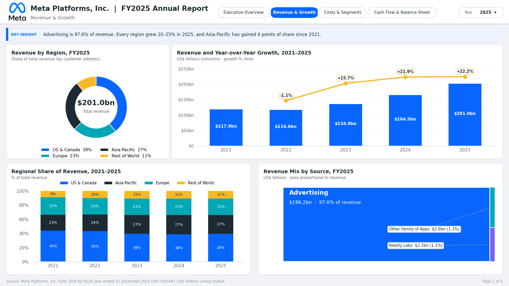
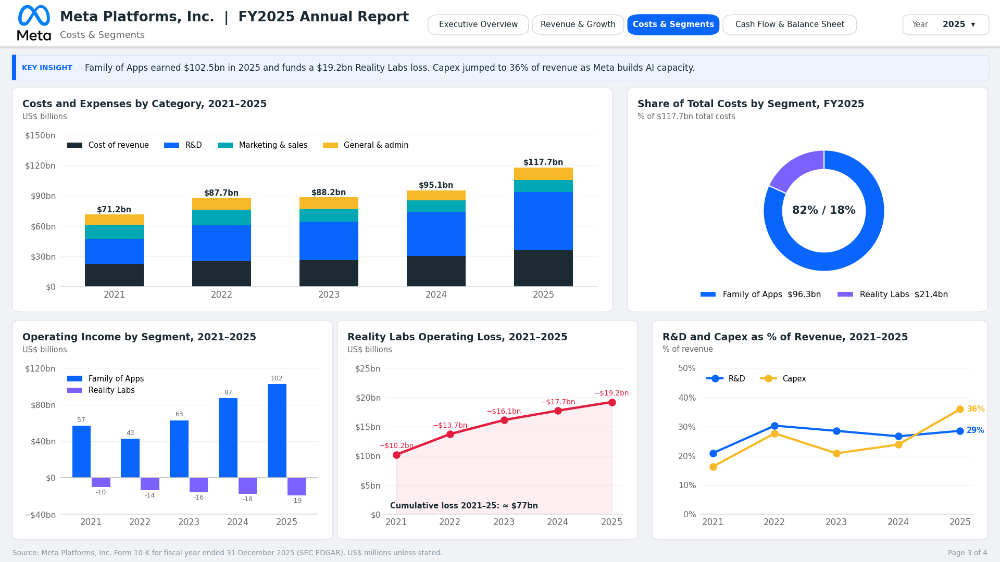
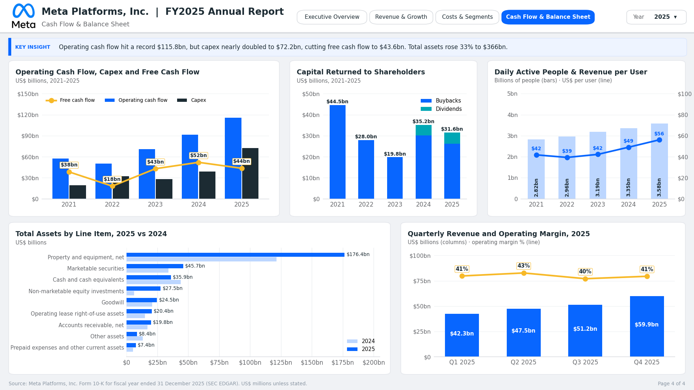

# Meta Platforms, Inc. — FY2025 Annual Report Analysis (Power BI)


An interactive four-page Power BI dashboard analysing **Meta Platforms, Inc.'s Annual Report (Form 10-K) for the fiscal year ended 31 December 2025**, with five-year trends from 2021 to 2025. The report covers revenue growth, profitability, segment performance, the cost of Meta's AI investment, cash flow, the balance sheet and user metrics.

> **Note:** The dashboard images below are design previews built from the same dataset used in the Power BI report.

---

## Table of Contents

1. [Project Overview](#1-project-overview)
2. [Business Questions](#2-business-questions)
3. [Data Source](#3-data-source)
4. [Repository Structure](#4-repository-structure)
5. [Data Preparation](#5-data-preparation)
6. [Data Model](#6-data-model)
7. [DAX Measures](#7-dax-measures)
8. [Dashboard Pages](#8-dashboard-pages)
9. [Key Findings](#9-key-findings)
10. [Design System](#10-design-system)
11. [How to Use](#11-how-to-use)
12. [Limitations](#12-limitations)
13. [Tools Used](#13-tools-used)
14. [Author](#14-author)

---

## 1. Project Overview

Meta is one of the world's largest technology companies, operating Facebook, Instagram, Messenger, WhatsApp and Threads (the **Family of Apps**) and its augmented and virtual reality business (**Reality Labs**). In 2025 the company sharply increased spending on AI infrastructure while continuing to fund large Reality Labs losses.

This project extracts the key financial and operating data from Meta's FY2025 annual report into a structured Excel dataset and visualises it in Power BI, so that a reader can understand Meta's financial position in a few minutes.

**Scope**

| Item | Detail |
|---|---|
| Company | Meta Platforms, Inc. (NASDAQ: META) |
| Main report | Form 10-K, fiscal year ended 31 December 2025 (filed 29 January 2026) |
| Period analysed | FY2021 – FY2025 (annual), Q1–Q4 2025 (quarterly) |
| Currency | US$ millions (displayed in US$ billions) |
| Output | 4 report pages · 5 KPI cards · 17 charts |

---

## 2. Business Questions

1. How fast is Meta growing, and where does its revenue come from (by product and by region)?
2. How profitable is Meta, and why did net income fall in 2025 while operating income rose?
3. How much does Reality Labs lose, and how is it funded?
4. How large is Meta's AI investment, and what is its effect on cash flow?
5. How has the balance sheet changed, and how much cash is returned to shareholders?
6. How are users and revenue per user developing?

---

## 3. Data Source

| Source | Used for |
|---|---|
| [Meta Form 10-K FY2025 (SEC EDGAR)](https://www.sec.gov/ix?doc=/Archives/edgar/data/1326801/000162828026003942/meta-20251231.htm) | Income statement, balance sheet, cash flow, segments, revenue by geography, headcount, Reality Labs plans |
| Meta Q4 and full-year 2025 results release (Exhibit 99.1) | Free cash flow, daily active people, capital expenditure |
| Meta quarterly results releases, Q1–Q4 2025 | Quarterly revenue, operating income, net income, capex |
| Meta Form 10-K filings, FY2021–FY2024 | Historical comparatives for the five-year trends |

All figures were typed from the filings and cross-checked: the balance sheet balances, quarters sum to full-year totals, and the revenue-to-net-income bridge reconciles to reported net income ($60,458m).

---

## 4. Repository Structure

```
meta-fy2025-powerbi-analysis/
├── README.md
├── Meta_FY2025_Dashboard.pbix            # Power BI report
├── Meta_FY2025_Dashboard.pdf             # PDF export of all four pages
├── data/
│   └── Meta_Annual_Report_PowerBI_Data.xlsx
├── theme/
│   └── Meta_FY2025_Theme.json            # Power BI report theme
└── images/
    ├── Page1_Executive_Overview.png
    ├── Page2_Revenue_Growth.png
    ├── Page3_Costs_Segments.png
    └── Page4_Cash_Flow_Balance_Sheet.png
```

---

## 5. Data Preparation

The Excel workbook holds one formatted Excel table per sheet so Power BI can import each table directly.

| Sheet | Power BI table | Contents |
|---|---|---|
| Income_Statement | `tblIncome` | Revenue, cost lines, operating income, tax, net income, EPS (2021–2025) |
| Segments | `tblSegments` | Family of Apps vs Reality Labs revenue and operating income |
| Revenue_Mix | `tblRevenueMix` | Advertising / other Family of Apps / Reality Labs revenue (long format) |
| Geography | `tblGeography` | Revenue by region (long format) |
| Balance_Sheet | `tblBalanceSheet` | All balance sheet line items, 2025 vs 2024 (long format) |
| Cash_Flow | `tblCashFlow` | Operating cash flow, capex, free cash flow, buybacks, dividends |
| KPIs | `tblKPIs` | Daily active people, headcount, revenue per user and per employee |
| Quarterly_2025 | `tblQuarterly` | Q1–Q4 2025 results |
| Investment_Split | `tblInvestment` | 2025 cost split by segment; 2026 Reality Labs spending plan |
| Ratios | `tblRatios` | Growth, margins, tax rate, R&D %, capex %, FCF margin (formula-driven) |
| Waterfall_2025 | `tblWaterfall` | Revenue-to-net-income bridge |
| Dim_Year | `tblYear` | Year dimension for cross-page filtering |

**Preparation steps**

- Hard-coded inputs (from the filings) are kept separate from calculated values (Excel formulas), so every derived number is traceable.
- Data that is compared across categories (regions, revenue sources, balance sheet items) is stored in **long format** for legends and slicers.
- Free cash flow follows Meta's definition: operating cash flow − purchases of property and equipment − principal payments on finance leases.
- In Power Query, "United States and Canada" is shortened to "US & Canada" for cleaner labels.
- Money columns use the custom format `$#,0.0,"bn"`, so values stored in millions display in billions.

---

## 6. Data Model

A star-style model with a single year dimension. `tblYear` filters all annual fact tables through one-to-many relationships on `Year`, so one slicer controls every page.

```
                          ┌──────────────┐
                          │   tblYear    │
                          │  Year (1)    │
                          └──────┬───────┘
                                 │ 1 : *
   ┌──────────┬──────────┬───────┼────────┬──────────┬────────┬──────────┐
   ▼          ▼          ▼       ▼        ▼          ▼        ▼          ▼
tblIncome tblSegments tblRevenueMix tblGeography tblCashFlow tblKPIs tblRatios tblBalanceSheet

Standalone tables: tblQuarterly · tblWaterfall · tblInvestment
```

Trend charts (2021–2025) have their interaction with the year slicer set to **None** so they always show all five years, while KPI cards and composition charts follow the slicer.

---

## 7. DAX Measures

```DAX
Total Revenue      = SUM ( tblIncome[Revenue] )
Operating Income   = SUM ( tblIncome[Operating_Income] )
Net Income         = SUM ( tblIncome[Net_Income] )
Free Cash Flow     = SUM ( tblCashFlow[Free_Cash_Flow] )
Operating Margin % = DIVIDE ( [Operating Income], [Total Revenue] )
Net Margin %       = DIVIDE ( [Net Income], [Total Revenue] )

Prior Year = MAX ( tblYear[Year_Num] ) - 1

Revenue PY =
    CALCULATE ( [Total Revenue], FILTER ( ALL ( tblYear ), tblYear[Year_Num] = [Prior Year] ) )

Revenue YoY % = DIVIDE ( [Total Revenue] - [Revenue PY], [Revenue PY] )

-- KPI card text and conditional colour
Revenue Card      = FORMAT ( [Total Revenue] / 1000, "$#,0.0" ) & "bn"
Revenue Chg Text  = IF ( [Revenue YoY %] >= 0, "▲ ", "▼ " )
                    & FORMAT ( ABS ( [Revenue YoY %] ), "0%" ) & " vs " & [Prior Year]
Revenue Chg Color = IF ( [Revenue YoY %] >= 0, "#31A24C", "#E41E3F" )

-- Chart helpers
Revenue Bar Color = IF ( SELECTEDVALUE ( tblIncome[Year] ) = "2025", "#0866FF", "#BCD6FF" )
RL Loss           = - SUM ( tblSegments[RL_Operating_Income] )
```

The same prior-year, change and colour pattern is repeated for operating income, net income, free cash flow and EPS.

---

## 8. Dashboard Pages

Every page shares the same layout: a header with the company logo, report title, page navigation tabs and a year slicer; a **Key Insight** strip summarising the page; and a source footer.

### Page 1 — Executive Overview



**What it shows:** five headline KPI cards with year-on-year change, the five-year revenue trend, operating vs net margin, and a waterfall bridging 2025 revenue to net income.

**Insight:** Revenue grew 22% to $201.0bn and operating margin held at 41%. Net income dipped 3% to $60.5bn only because of a one-off tax charge in Q3 2025, which raised the effective tax rate to 30% (about 13% without it). R&D ($57.4bn) is the largest cost in the bridge.

| Visual | Type |
|---|---|
| Revenue, Operating income, Net income, Free cash flow, Diluted EPS | KPI cards |
| Annual Revenue, 2021–2025 | Clustered column (2025 highlighted) |
| Operating Margin vs Net Margin, 2021–2025 | Line |
| From Revenue to Net Income, FY2025 | Waterfall |

---

### Page 2 — Revenue & Growth



**What it shows:** where revenue comes from by region and by source, and how growth has changed since 2021.

**Insight:** Advertising is 97.6% of revenue ($196.2bn), a significant concentration. US & Canada is the largest region (39%), but every region grew about 20–21% in 2025 and Asia-Pacific has gained four points of share since 2021. Growth recovered from −1.1% in 2022 to 22.2% in 2025.

| Visual | Type |
|---|---|
| Revenue by Region, FY2025 | Donut |
| Revenue and Year-over-Year Growth, 2021–2025 | Line and clustered column |
| Regional Share of Revenue, 2021–2025 | 100% stacked column |
| Revenue Mix by Source, FY2025 | Treemap |

---

### Page 3 — Costs & Segments



**What it shows:** how costs are growing, how they split between the two segments, and the cost of Meta's investment in AI and Reality Labs.

**Insight:** Total costs reached $117.7bn, with R&D more than doubling since 2021. Family of Apps earned $102.5bn of operating income in 2025, which funds a Reality Labs loss of $19.2bn (about $77bn lost over 2021–2025). Capital expenditure jumped to 36% of revenue as Meta builds AI data centres.

| Visual | Type |
|---|---|
| Costs and Expenses by Category, 2021–2025 | Stacked column |
| Share of Total Costs by Segment, FY2025 | Donut |
| Operating Income by Segment, 2021–2025 | Clustered column |
| Reality Labs Operating Loss, 2021–2025 | Line with shaded area |
| R&D and Capex as % of Revenue, 2021–2025 | Line |

---

### Page 4 — Cash Flow & Balance Sheet



**What it shows:** cash generation and use, shareholder returns, the asset base, user growth and the 2025 quarterly trend.

**Insight:** Operating cash flow hit a record $115.8bn, but capex nearly doubled to $72.2bn, cutting free cash flow from $52.1bn to $43.6bn. Total assets rose 33% to $366bn, driven by property and equipment ($176.4bn). Meta returned $31.6bn to shareholders, mostly through buybacks. Daily active people reached 3.58bn and revenue per user rose to about $56.

| Visual | Type |
|---|---|
| Operating Cash Flow, Capex and Free Cash Flow | Line and clustered column |
| Capital Returned to Shareholders | Stacked column |
| Daily Active People & Revenue per User | Line and clustered column (dual axis) |
| Total Assets by Line Item, 2025 vs 2024 | Clustered bar |
| Quarterly Revenue and Operating Margin, 2025 | Line and clustered column |

---

## 9. Key Findings

| Area | Finding |
|---|---|
| Growth | Revenue up 22% to $201.0bn; third consecutive year of strong growth after a slight decline in 2022. |
| Profitability | Operating margin steady at 41%; net income down 3% due to a one-off tax charge, not weaker operations. |
| Revenue concentration | 97.6% of revenue comes from advertising, making Meta sensitive to the ad market and regulation. |
| Geography | Growth was broad-based across all regions; Asia-Pacific's share is rising. |
| AI investment | R&D of $57.4bn and capex of $72.2bn (36% of revenue) show a major shift toward AI infrastructure. |
| Reality Labs | Losses widened every year to $19.2bn in 2025; the segment is funded by Family of Apps profits. |
| Cash flow | Record operating cash flow, but free cash flow fell 16% because of heavy capex. |
| Balance sheet | Assets up 33%; long-term debt doubled to $58.7bn to help fund investment. |
| Users | 3.58bn daily active people; revenue per user is rising faster than the user base. |

**Overall:** Meta's core advertising business is growing and highly profitable. The key question for investors is whether its large AI and Reality Labs investments, which are compressing free cash flow, will deliver returns.

---

## 10. Design System

| Element | Specification |
|---|---|
| Canvas | 16:9, 1280 × 720 px, background `#F0F2F5` |
| Cards | White, 1 px border `#E4E6EB`, 10 px rounded corners |
| Font | Segoe UI / Segoe UI Semibold |
| Primary colour | Meta blue `#0866FF` (revenue, Family of Apps, current year) |
| Secondary colours | Navy `#1C2B33`, purple `#7B61FF` (Reality Labs), teal `#00A7B5`, amber `#F7B928` |
| Semantic colours | Green `#31A24C` (increase), red `#E41E3F` (decrease, losses) |
| Prior year | Light blue `#BCD6FF` |
| Navigation | Page navigator buttons in the header; synced year slicer on every page |
| Axes | Fixed round ranges, 5–6 ticks, no axis titles; units in chart subtitles |
| Lines | Linear interpolation (no smoothing), markers on |

The full theme is in [`theme/Meta_FY2025_Theme.json`](theme/Meta_FY2025_Theme.json).

---

## 11. How to Use

1. Download or clone this repository.
2. Open `Meta_FY2025_Dashboard.pbix` in **Power BI Desktop** (free from the Microsoft Store).
3. If prompted, update the data source path: **Transform data > Data source settings > Change source** and select `data/Meta_Annual_Report_PowerBI_Data.xlsx`.
4. Use the **Year** slicer (top right) to change the KPI cards and composition charts.
5. **Ctrl + click** the page tabs in the header to move between pages in Power BI Desktop.
6. No Power BI? Open `Meta_FY2025_Dashboard.pdf` for a static version.

---

## 12. Limitations

- The analysis uses reported figures only; it does not include market data such as share price or valuation multiples.
- Regional revenue is based on customer billing address, which can differ from where users are located.
- 2021–2023 figures come from earlier 10-K filings and are not restated for later accounting changes.
- Quarterly data covers 2025 only.

---

## 13. Tools Used

| Tool | Purpose |
|---|---|
| Microsoft Power BI Desktop | Data modelling, DAX measures, dashboard design |
| Microsoft Excel | Data extraction, structuring and validation |
| Power Query | Data cleaning and transformation |
| DAX | KPI, growth and conditional-formatting measures |
| SEC EDGAR | Source filings |

---

## 14. Author

**Tosin Bello**
Data Analyst · Quantitative Analyst · Data Scientist

*Data source: Meta Platforms, Inc. public filings with the U.S. Securities and Exchange Commission. This project is for educational and analytical purposes and is not investment advice. Meta and the Meta logo are trademarks of Meta Platforms, Inc.*
